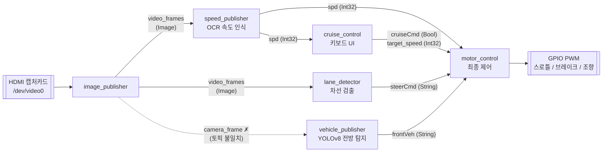

# avone — 화면 인식 기반 크루즈 컨트롤 / 차선 유지 (ROS 2 · Jetson)

캡처카드로 들어오는 **주행 화면(1920×1080)** 을 읽어서

- 화면 우측 하단의 **속도계 숫자를 OCR** 로 읽고,
- **차선을 검출**해 좌/우/중앙 조향 방향을 정하고,
- **전방 물체(차량)를 YOLOv8 로 탐지**해 감속 여부를 판단한 뒤,
- Jetson 의 **GPIO PWM 으로 스로틀 · 브레이크 · 스티어링 액추에이터를 구동**하는

간이 자율주행(ACC + LKAS 흉내) 시스템입니다. NVIDIA Jetson + ROS 2(Foxy) `ament_python` 패키지로 작성되어 있습니다.

> 화면 속 속도계 위치(ROI)와 "하단은 보닛이라 제외" 같은 주석으로 보아, 실제 카메라보다는 **주행 시뮬레이터/게임 화면을 HDMI 캡처카드로 받아** 물리 페달·핸들 장치를 움직이는 용도로 보입니다(코드에서 추정한 내용).

> ⚠️ **현재 상태: 프로토타입 / 미완성.** 그대로 실행하면 동작하지 않는 부분이 여럿 있습니다. 아래 [알려진 문제점](#알려진-문제점)을 먼저 확인하세요.

---

## 시스템 구조



데이터 흐름 요약:

1. `image_publisher` 가 캡처카드에서 프레임을 읽어 `video_frames` 로 발행
2. 인식 노드 3개(`speed_publisher`, `lane_detector`, `vehicle_publisher`)가 각각 프레임을 분석해 결과 토픽 발행
3. 운전자가 `cruise_control` 터미널에서 크루즈를 켜면 현재 속도를 5 km/h 단위로 반올림해 목표 속도로 설정
4. `motor_control` 이 모든 토픽을 모아 10 Hz 루프로 스로틀/브레이크/조향 PWM 값을 결정

---

## 디렉터리 구성

```
avone/
├── package.xml              # ROS 2 패키지 메타데이터 (ament_python)
├── setup.py / setup.cfg     # 실행 파일(entry point) 등록
├── resource/avone           # ament 인덱스 마커
├── launch/
│   └── auto_launch.py       # 전체 노드 일괄 실행 런치 파일
├── avone/
│   ├── image_publisher.py   # 캡처카드 → video_frames
│   ├── speed_publisher.py   # 속도계 OCR → spd
│   ├── lane_detector.py     # 차선 검출 → steerCmd
│   ├── vehicle_publisher.py # YOLOv8 전방 물체 탐지 → frontVeh
│   ├── cruise_control.py    # 키보드 크루즈 UI → cruiseCmd, target_speed
│   ├── motor_control.py     # 통합 제어 → GPIO PWM
│   ├── testLed.py           # (단독 스크립트) 상태 LED 테스트
│   ├── sampleCode.py        # (단독 스크립트) 캡처카드 화면 확인
│   └── instruction.xml      # 설치 메모 + 토픽 목록 (실제로는 일반 텍스트)
└── test/                    # ament 기본 린트 테스트 (flake8, pep257, copyright)
```

---

## 노드 상세

### `image_publisher` — 영상 입력
| 항목 | 내용 |
|---|---|
| 입력 | `cv2.VideoCapture(0)` (캡처카드), 해상도 1920×1080 요청 |
| 출력 | `video_frames` (`sensor_msgs/Image`, bgr8) |
| 주기 | 0.2 s 타이머 → **약 5 fps** (주석의 "2fps"는 예전 값) |

파일 상단에는 녹화 영상(`video.mp4`)을 `camera_frame` 토픽으로 발행하는 **테스트용 `VideoPublisher`** 가 `"""` 문자열로 주석 처리되어 남아 있습니다. 실제로 동작하는 것은 하단의 `ImagePublisher` 입니다.

### `speed_publisher` — 속도계 OCR
| 항목 | 내용 |
|---|---|
| 입력 | `video_frames` |
| 출력 | `spd` (`std_msgs/Int32`, km/h) |
| 방식 | 고정 ROI `x=1732, y=1019, w=38, h=25` 를 잘라 그레이스케일 → `pytesseract` (`--psm 7`, 한 줄 모드) → `int()` 변환 |

변환에 실패하면 경고 로그만 남기고 발행하지 않습니다. ROI 좌표는 특정 화면 레이아웃에 하드코딩되어 있습니다.

### `lane_detector` — 차선 검출 / 조향 방향 결정
| 항목 | 내용 |
|---|---|
| 입력 | `video_frames` |
| 출력 | `steerCmd` (`std_msgs/String`: `left` / `center` / `right`) |

처리 순서:
1. 사다리꼴 ROI 마스크 적용 — `(525,725) (825,570) (1125,570) (1425,725)`
2. 그레이스케일 → Canny(100, 200)
3. `HoughLinesP` (threshold 100, minLineLength 50, maxLineGap 30)
4. 기울기 `|slope|` 가 0.5 ~ 5.0 인 선만 사용, 음수면 왼쪽 차선 / 양수면 오른쪽 차선
5. 좌·우 차선 x 좌표 평균의 중점 = 차선 중심, 화면 중심과의 차이 = `offset`
6. `offset > 50px` → `right`, `offset < -50px` → `left`, 그 외 `center`

좌/우 차선이 **둘 다** 검출되어야만 명령을 발행합니다. 검출 결과(녹색 선)를 그린 프레임을 현재 작업 디렉터리에 `lane_frame_<초>.jpg` 로 **매번 저장**합니다(디버그용).

### `vehicle_publisher` — 전방 물체 탐지
| 항목 | 내용 |
|---|---|
| 입력 | `camera_frame` (※ `image_publisher` 는 `video_frames` 로 발행 — 불일치) |
| 출력 | `frontVeh` (`std_msgs/String`: `None` / `Neutral` / `Brake`) |
| 모델 | Ultralytics `yolov8n.pt` (사전학습 가중치) |

ROI `y 500~593, x 530~1390` (전방 도로 띠 영역)을 잘라 YOLOv8 로 추론한 뒤, 첫 번째 탐지 객체의 세로 중심 위치로 거리를 판단합니다.
- 화면 상단 1/3 → `Neutral` (멀리 있음)
- 화면 중간 1/3 → `Brake` (가까움)
- 탐지 없음 → `None`

클래스 필터링이 없어 차량이 아닌 물체도 모두 대상이 됩니다.

### `cruise_control` — 크루즈 조작 UI
| 항목 | 내용 |
|---|---|
| 입력 | `spd` (크루즈 시작 시 **한 번만** 구독) |
| 출력 | `cruiseCmd` (`Bool`), `target_speed` (`Int32`) |
| UI | `curses` 기반 비차단 키 입력 |

| 키 | 동작 |
|---|---|
| `s` | 크루즈 ON. `spd` 를 1회 받아 5 km/h 단위로 반올림한 값을 목표 속도로 발행 후 구독 해제 |
| `x` | 크루즈 OFF |
| `u` / `d` | 목표 속도 ±5 km/h (크루즈 ON 상태에서만, 최소 0) |
| `q` | 종료 |

파일 하단에는 `input()` + 스레드 방식의 이전 버전과, 속도를 계속 구독하는 리팩토링 버전이 문자열 주석으로 남아 있습니다.

### `motor_control` — 통합 차량 제어 (미완성)
| 항목 | 내용 |
|---|---|
| 입력 | `spd`, `target_speed`, `cruiseCmd`, `steerCmd`, `frontVeh` |
| 출력 | Jetson GPIO PWM (BCM 모드) |

| 핀 (BCM) | 용도 | PWM 주파수 |
|---|---|---|
| 18 | 스로틀 | 100 Hz |
| 19 | 브레이크 | 100 Hz |
| 20 | 스티어링 서보 | 50 Hz (중립 duty 7.5 %) |

제어 로직 (`control_vehicle`, 약 10 Hz):
- **크루즈 OFF** → 스로틀 0, 브레이크 0 후 종료(조향도 하지 않음)
- **전방 `None`/`Neutral`** → 브레이크 해제, `throttle = 100 × 0.5 × (tanh(clip((목표−현재)/목표, −1, 1)) + 1)`
- **전방 `Brake`** → 스로틀 0, 브레이크 100 %
- **조향** → 최대 ±15°, 속도가 높을수록 조향각 감소 (`factor = max(0.1, 1 − v/100)`), `duty = 7.5 + (angle/90) × 2.5`

> `setup.py` 에는 `motor_control` 이 등록되어 있지만 **런치 파일에는 포함되어 있지 않습니다.** 파일 상단 주석에도 "아직 구현 시작도 안 한 거"라고 적혀 있습니다.

### 보조 스크립트 (ROS 노드 아님)
- **`testLed.py`** — BOARD 핀 15(LDWS), 7(크루즈 ON), 11(크루즈 OFF) 상태 LED 테스트. `r`/`g`/`y` 입력으로 각 LED 점등. 아직 메인 노드에는 연동되지 않음(`motor_control` 에 `# turn led on` 자리만 있음).
- **`sampleCode.py`** — 캡처카드 영상을 OpenCV 창으로 띄워 연결 상태를 확인하는 스크립트.

---

## 토픽 목록

| 토픽 | 타입 | 발행 | 구독 | 의미 |
|---|---|---|---|---|
| `video_frames` | `sensor_msgs/Image` | image_publisher | speed_publisher, lane_detector | 캡처 프레임 |
| `camera_frame` | `sensor_msgs/Image` | (테스트용 VideoPublisher, 현재 주석 처리) | vehicle_publisher | 테스트 영상 프레임 |
| `spd` | `std_msgs/Int32` | speed_publisher | cruise_control, motor_control | 현재 속도 (1 km/h 단위) |
| `target_speed` | `std_msgs/Int32` | cruise_control | motor_control | 목표 속도 (5 km/h 단위) |
| `cruiseCmd` | `std_msgs/Bool` | cruise_control | motor_control | 크루즈 ON/OFF |
| `steerCmd` | `std_msgs/String` | lane_detector | motor_control | `left` / `center` / `right` |
| `frontVeh` | `std_msgs/String` | vehicle_publisher | motor_control | `None` / `Neutral` / `Brake` |

(`instruction.xml` 에 적힌 `speedCmd` 토픽은 코드 어디에서도 사용하지 않습니다.)

---

## 설치

`avone/instruction.xml` 의 메모를 정리한 내용입니다. 대상 환경은 JetPack(Ubuntu 20.04) + ROS 2 Foxy 입니다.

```bash
# 1. JetPack / Ubuntu 버전 확인
cat /etc/nv_tegra_release
lsb_release -a

# 2. ROS 2 Foxy 설치 (공식 가이드 참고) 후
echo "source /opt/ros/foxy/setup.bash" >> ~/.bashrc
sudo apt install python3-colcon-common-extensions

# 3. Python / 시스템 의존성
sudo apt install python3-pip tesseract-ocr ros-foxy-cv-bridge
sudo pip3 install Jetson.GPIO pytesseract opencv-python numpy ultralytics
```

> `package.xml` 에는 런타임 의존성(`rclpy`, `sensor_msgs`, `std_msgs`, `cv_bridge` 등)이 선언되어 있지 않으므로 `rosdep` 으로는 설치되지 않습니다. 위처럼 수동으로 설치해야 합니다.

## 빌드

```bash
mkdir -p ~/ros2_ws/src
cp -r avone ~/ros2_ws/src/
cd ~/ros2_ws
colcon build --packages-select avone
source install/setup.bash
```

## 실행

### 런치 파일로 일괄 실행
```bash
ros2 launch avone auto_launch.py
```
> 현재 런치 파일은 존재하지 않는 실행 파일 `vehicle_detector` 를 참조하므로 **그대로는 실패합니다** (아래 문제점 참고).

### 노드 개별 실행 (권장)
```bash
ros2 run avone image_publisher
ros2 run avone speed_publisher
ros2 run avone lane_detector
ros2 run avone vehicle_publisher
ros2 run avone motor_control      # GPIO 접근 권한 필요
ros2 run avone cruise_control     # 반드시 별도 터미널에서 (curses UI)
```

`cruise_control` 은 curses 로 터미널을 직접 제어하므로 `ros2 launch` 안에서 실행하면 키 입력을 받을 수 없습니다. 별도 터미널에서 `ros2 run` 으로 띄우는 것이 맞습니다.

### 하드웨어 점검용
```bash
python3 avone/sampleCode.py   # 캡처카드 화면 확인 (q 로 종료)
python3 avone/testLed.py      # LED 점등 테스트
```

---

## 알려진 문제점

코드를 읽으며 발견한, 실제 동작을 막거나 의도와 다르게 동작하는 부분입니다.

### 실행 자체가 실패하는 문제
| 위치 | 문제 | 수정 방향 |
|---|---|---|
| `launch/auto_launch.py:33` | `vehicle_detector` 실행 파일이 `setup.py` 에 없음 → 런치 실패 | `vehicle_publisher` 로 변경 |
| `launch/auto_launch.py:49` | "모터 제어 노드" 주석 아래에 `vehicle_publisher` 가 들어가 있고, `motor_control` 은 런치에 없음 | `motor_control` 로 변경 |
| `avone/motor_control.py:27` vs `:62`, `:127` | 스로틀 PWM 을 `self.pwm` 으로 만들고 `self.throttle_pwm` 으로 사용 → `AttributeError` | 이름 통일 |
| `avone/motor_control.py:56` | `target_speed == 0` 일 때 0으로 나눔 → `ZeroDivisionError` (크루즈 ON 직후 `target_speed` 수신 전에도 발생 가능) | 0 체크 추가 |
| `avone/vehicle_publisher.py:56` | `results.xyxy[0]` 은 YOLOv5(torch hub) API. Ultralytics YOLOv8 은 `results[0].boxes.xyxy / .conf / .cls` 를 사용 | API 교체 |

### 동작이 의도와 다른 문제
| 위치 | 문제 |
|---|---|
| `avone/vehicle_publisher.py:26` | `camera_frame` 을 구독하지만 실제 영상은 `video_frames` 로 발행됨 → 프레임을 한 장도 받지 못함 |
| `avone/vehicle_publisher.py:63`, `:68` | 박스 좌표는 ROI(높이 93px) 기준인데 전체 프레임 높이(1080)의 1/3(360px)과 비교 → 항상 `Neutral`, **`Brake` 가 절대 나오지 않음** |
| `avone/vehicle_publisher.py` | 클래스 필터링 없음 → 차량 외 모든 물체에 반응 |
| `avone/motor_control.py:56-58` | `tanh` 범위 때문에 스로틀이 약 12 %~88 % 사이에서만 움직이고, 목표 속도에 도달해도 50 %, 초과해도 0 이 되지 않음. 브레이크는 0 또는 100 % 뿐 |
| `avone/motor_control.py:81` | 주석은 ±15° → duty 5 / 10 이라고 하지만 실제 계산은 7.5 ± 0.42 → 서보가 거의 움직이지 않음 |
| `avone/motor_control.py` | 크루즈 OFF 시 조기 `return` 으로 조향도 함께 멈춤 (LKAS 가 크루즈에 종속) |
| `avone/motor_control.py:25` | Jetson.GPIO 의 PWM 은 하드웨어 PWM 지원 핀에서만 동작(보드별로 상이, 예: Nano 는 BOARD 32/33). BCM 18/19/20 이 해당 보드에서 PWM 을 지원하는지 확인 필요 |
| `avone/lane_detector.py:97` | 차선이 검출될 때마다 jpg 를 현재 디렉터리에 저장 → 디스크 사용량 증가 및 처리 지연 |
| `avone/speed_publisher.py:34` | 숫자 화이트리스트가 없어 오인식이 잦을 수 있음 (`-c tessedit_char_whitelist=0123456789` 권장) |
| `avone/image_publisher.py:84` | 주석은 2 fps 이지만 실제 주기는 0.2 s(5 fps) |
| ROI 전반 | 모든 ROI 좌표가 1920×1080 특정 화면에 하드코딩되어 있음 → ROS 파라미터로 분리 권장 |
| `package.xml` | 설명/라이선스가 `TODO` 이고 런타임 의존성 미선언 |

---

## TODO (코드 주석 기준)

- [ ] 속도 OCR 정확도 개선 (`speed_publisher.py` 상단 `# todo`)
- [ ] `motor_control` 구현 완성 및 런치 파일 편입
- [ ] 크루즈 / LDWS 상태 LED 를 `motor_control` 에 연동 (`testLed.py` 핀 배치 사용)
- [ ] 조향각 공식 보정 ("기계과 조향각 공식 도움 필요" 주석)
- [ ] 반응 속도 문제 시 캡처 fps 상향
